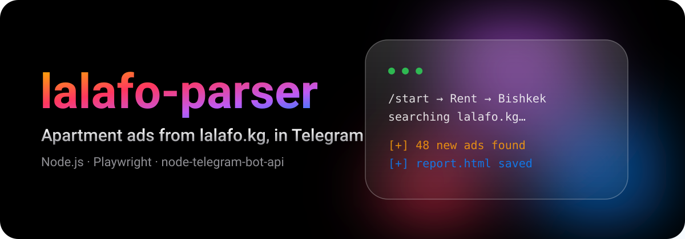

<p align="center">
  
</p>

<p align="center">
  <b>A Node.js bot that collects apartment ads from lalafo.kg<br>and is controlled through Telegram.</b><br>
  <sub>Node.js · node-telegram-bot-api · got-scraping · Playwright · ExcelJS</sub>
</p>

<br>

## ✨ Features

- 🏠 **Categories:** rent, sale, buy and wanted apartments
- 🗺️ **City picker:** a paged menu built from `locations.json`
- 💬 **One self-updating menu message:** no chat spam
- 📄 **HTML report:** the found ads are saved to a file
- 🧠 **Memory:** ads already seen are skipped (`seen_ids.json`)

## ⚡ Quick start

```bash
git clone https://github.com/Doosi41/lalafo-parser.git && cd lalafo-parser
npm install
echo "TELEGRAM_TOKEN=your_bot_token" > .env   # token from @BotFather
node index.js
```

## 🗂️ Files

| File | What it does |
|:--|:--|
| `index.js` | The Telegram bot and its menus |
| `api.js` | Requests to the lalafo.kg search API |
| `browser.js` | Gets fresh cookies with a browser |
| `htmlGenerator.js` | Builds the HTML report |
| `state.js` | Keeps the list of seen ads |
| `config.js`, `locations.json` | Settings and cities |

## ⚠️ Notes

- Be polite to the website: do not send many requests in a short time and follow its terms of use.
- Ads contain personal data such as phone numbers. Do not publish the reports or `seen_ids.json`; they are in `.gitignore`.
- Never commit `.env`.

<br>

<p align="center">
  <sub>Stay hungry. Stay foolish.</sub>
</p>
